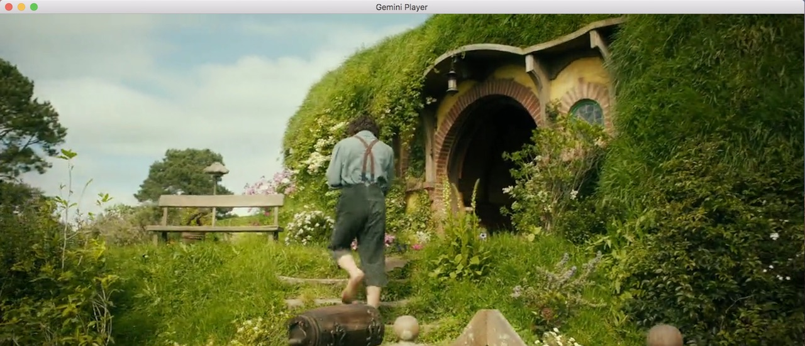
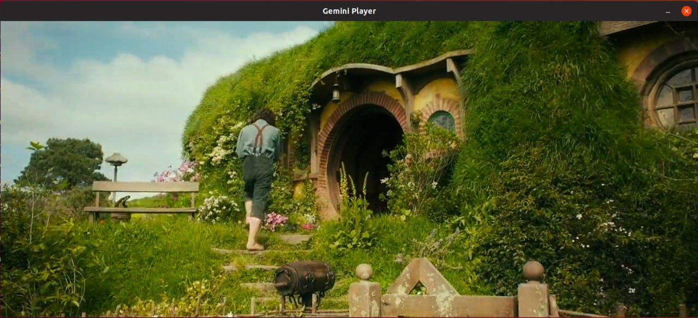

Media-Player
============

*本项目已停止更新，欢迎使用我新开发的播放器项目。* [Aurora Player](https://github.com/lmshao/Aurora)
*This project is no longer being updated. Feel free to try my newly developed media player project.* [Aurora Player](https://github.com/lmshao/Aurora)

基于FFmpeg (4.0) + SDL2的视频播放器。

系统要求： Linux / MacOS

### 环境配置

#### FFmpeg
```sh
$ ./configure --enable-shared --enable-gpl --enable-version3 --enable-nonfree --enable-postproc --enable-pthreads --enable-libfdk-aac --enable-libmp3lame  --enable-libx264 --enable-libxvid --enable-libvorbis --enable-libx265
or
$ ./configure --enable-shared
$ make
# make install
```   
#### SDL2
```sh
$ ./configure
$ make
# make install
```
### 状态
2018-7-14   
把音频解码放在音频播放回调函数线程里调用，解决了同时播放音视频卡顿的问题。单独播放音频因为没有视频帧控制的延时，导致快速读取完音频包后销毁了主线程。

### UI
#### MacOS screenshot


#### Ubuntu screenshot

